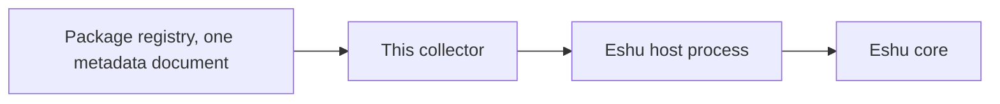

# eshu-collector-package-registry

Status: pre-release. Please don't rely on it in production yet.

In a nutshell: this collector reads package details (names, versions,
dependencies) from one package feed and hands Eshu a checked summary
of what it found. Eshu is the core system, and a collector is a small
helper that reads one outside system and turns what it finds into
facts, which are small typed records. It fetches one bounded metadata
document per claim and parses it. It never publishes, installs, or
runs a package.

Text version: package registry, then this collector, then the Eshu
host process (it checks and stores the result), then Eshu core. The
collector never talks to Eshu's database directly.

## When you'd use it

Use it when Eshu needs current package, version, and dependency
details from a feed it can read with one bounded HTTPS document per
claim, refreshed on a schedule Eshu controls.

Don't use it to publish packages, install or run package code, or
prove a package is safe. The vulnerability facts here are hints copied
from the document, not a scan. Metadata in, metadata out.

## How Eshu runs it

Eshu's host starts the program for one claim (one job) at a time.
It writes one bounded `collector-sdk/v1alpha1` request to stdin and
reads one result from stdout: `collector --sdk-stdio`.
The collector gets no Postgres, graph, queue, lease, or workflow handle.
The host validates the result and owns claims and commits.

## Documentation

| Page | What's in it |
| --- | --- |
| [Documentation](docs/README.md) | Start here: the whole docs tree in one index |
| [Getting started](docs/getting-started/README.md) | The fastest honest path to a first successful claim |
| [Concepts](docs/concepts/README.md) | What it does, the facts story, identity and grants, and what it never does |
| [Configuration](docs/reference/configuration.md) | Every setting, credentials, limits, and identity on a switch |
| [Facts](docs/reference/facts.md) | The fact kinds, schemas, and confidence, mirroring the manifest |
| [Guides](docs/guides/README.md) | Seed and enable, operate, troubleshoot, release |
| [Diagrams](docs/diagrams/README.md) | Every diagram, each with a text version |
| [Example config](config.example.yaml) | A full activation with comments, ready to copy |
| [Manifest](manifest.yaml) | Component identity, fact list, and the core version range |
| [Grant requests](grant.example.json) | The nine producer grants this component asks core for |
| [Epic 7 closeout](docs/epic-7-closeout.md) | Maintainer history: the CI-gates closeout evidence, kept for the record |
| [Contributing](CONTRIBUTING.md) | The lane contract and the local check |

## Related repos

- [Eshu core](https://github.com/eshu-hq/eshu) is the host that runs
  this collector, including the
  [SDK compatibility](https://github.com/eshu-hq/eshu/blob/main/docs/public/extend/sdk-compatibility.md)
  page the pins come from.
- [eshu-sdk](https://github.com/eshu-hq/eshu-sdk) holds the SDK modules
  in `go.mod` here: `collector v0.2.0-rc.1`, `factschema v0.1.0-rc.5`,
  on Go `1.26.10` (full table in [configuration](docs/reference/configuration.md)).
- [eshu-deploy](https://github.com/eshu-hq/eshu-deploy) is related
  reading for deployment examples only. It isn't a dependency, and
  nothing in this tree references it outside this list.

## Development

`make ci` is the whole local check: vet, lint, format, tidy, the
500-line cap, build, tests, and the race suite, same as CI.

## Contributing, security, and license

[CONTRIBUTING.md](CONTRIBUTING.md) covers the details. There's no
separate security policy file yet, so please report a suspected
vulnerability, or any way a secret or unsanitised address could slip
into a fact, to the maintainers privately instead of opening a public
issue. MIT, in [LICENSE](LICENSE).
